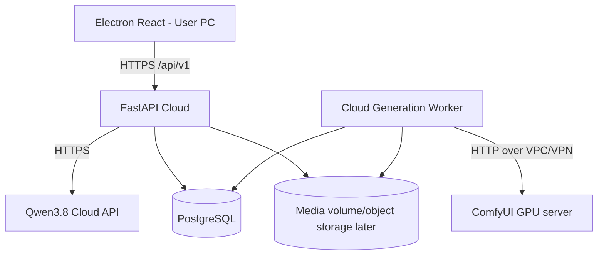

# 三端独立部署架构

## 规范

- **唯一入口**：正式环境桌面端仅访问 FastAPI HTTPS 域名，Qwen 和 GPU 凭据不发送到客户端。
- **地址配置**：Electron 设置界面切换云端域名；FastAPI 的 `.env` 配置模型地址；Worker 的 `gpu_nodes.json` 配置 GPU 节点；`manifests` 配置每个 ComfyUI API JSON 的节点 ID 和字段。
- **任务**：由 API 创建数据库任务，独立 Worker 领取。客户端退出后任务继续。Worker 启动时恢复 `submitting` 和 `running` 状态；保留已提交的 `comfy_prompt_id`，避免通常情况下重复提交。
- **素材**：客户端图片上传 FastAPI，后端存储并审核；Worker 从后端可见的文件卷上传到 GPU，生成结果保存到后端可见卷，客户端通过鉴权下载。
- **网络边界**：如果 GPU 节点在 NAT 后面，必须先配置私有 VPN / 专线 / 安全隧道；本版本未实现反向 GPU Agent，不支持直接把私有地址当成云端可访问地址。
- **生产安全**：HTTPS、令牌管理、容器私有网络、无公网 ComfyUI、业务审计、输入校验均为必要项。第一版只采用单共享令牌，不应直接用作多用户 SaaS。

## 任务状态

`queued → submitting → running → succeeded`，故障时进入 `failed`。失败任务可通过 `/generation-jobs/{id}/retry` 重新入队。重试可能使尚在 GPU 上运行的请求产生重复计算，生产部署应加入任务幂等与人工确认策略。

## 替换 GPU 工作流

1. 在 ComfyUI 里导出 **Workflow API JSON**，保存到对应 `workflows/comfyui/videos/...`。
2. 修改 manifest 的提示词节点、图片 LoadImage 节点、种子节点与视频输出节点 ID。
3. GPU 节点配置 `models` 中添加对应工作流 ID，并启用节点。
4. `/api/v1/workflows` 返回 `ready: true` 后才允许提交任务。
5. 使用一个图片、一个提示词做低负载测试，并核对实际输出键（`gifs`/`videos`/`images`）与节点 ID。

## 需进一步扩展的产品能力

- 用 OIDC + JWT 和项目 ACL 替换单共享令牌。
- 使用 S3/MinIO 对象存储替换共享磁盘，采用短期签名 URL 和审计。
- GPU Agent 主动连接云端，管理 NAT 后的 GPU 节点、节点健康和容量。
- 动态任务队列分配、多 worker GPU 租约、任务取消与超时续约。
- 视觉连续性质检、首帧预演、视频拼接和导出。
